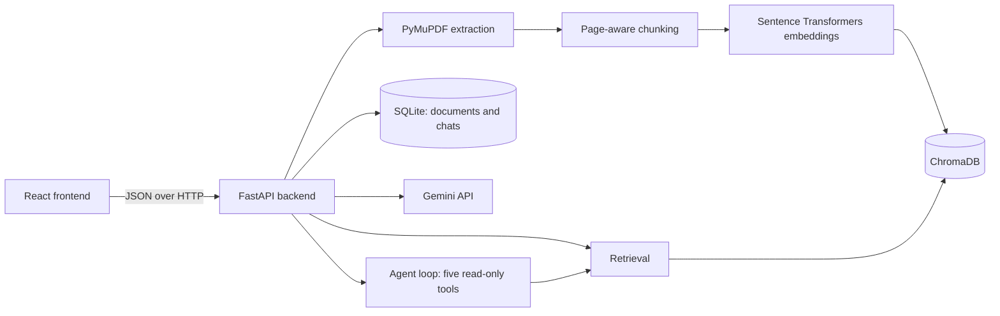

# AVARA: AI Virtual Assistant for Retrieval and Action

_Your Knowledge. Your AI Expert._

AVARA lets people ask questions about their organisation's PDF documents and get answers with page-level citations. When the documents don't contain the answer, AVARA says so instead of guessing. It also includes five read-only agent tools for policy extraction, document search, summaries, onboarding checklists, and task lists. Questions can be typed or spoken.

This is an individual project built as a recruitment showcase.

## Features

- Upload PDFs. Text is extracted page by page, so every citation shows a page number
- Semantic search over stored chunks, using local embeddings and ChromaDB
- Grounded answers with numbered citations, plus a "not covered" list when the sources only partly answer a question
- Follow-up questions, using conversation history stored in SQLite
- Agent tools page: policy extraction, knowledge search, document summary, onboarding checklist, and task list. Each tool runs at most once per request, with a limit of three tool calls
- Voice input in Chrome or Edge, and read-aloud for answers
- Evaluation runner with 12 questions, to check answers against expected pages and key facts

## Architecture



## Project structure

```
avara/
├── .env.example                   (template for the API key file)
├── .gitignore
├── DEPLOYMENT.md                  (local run and hosting notes)
├── PROJECT_STATUS.md              (build log, evaluation results, known issues)
├── README.md
├── backend/
│   ├── requirements.txt
│   ├── app/
│   │   ├── config.py              (settings from .env, folder paths)
│   │   ├── database.py            (SQLite: documents, chat sessions, messages)
│   │   ├── main.py                (FastAPI app, CORS, routers, /health)
│   │   ├── schemas.py             (request and response models)
│   │   ├── routers/
│   │   │   ├── documents.py       (upload, list, pages, delete)
│   │   │   ├── search.py          (GET /search)
│   │   │   ├── qa.py              (POST /ask, DELETE /ask/{session_id})
│   │   │   └── agent.py           (POST /agent)
│   │   └── services/
│   │       ├── storage.py         (upload validation and saving)
│   │       ├── extraction.py      (PyMuPDF page extraction)
│   │       ├── chunking.py        (page-aware chunking)
│   │       ├── embeddings.py      (Sentence Transformers)
│   │       ├── vector_store.py    (ChromaDB access)
│   │       ├── indexing.py        (chunk, embed, store)
│   │       ├── document_manager.py (delete across all stores)
│   │       ├── retrieval.py       (semantic search with relevance scores)
│   │       ├── llm.py             (Gemini client, retries, JSON output)
│   │       ├── rag.py             (grounded answers, citations, history rewrite)
│   │       ├── tools.py           (five read-only agent tools)
│   │       └── agent.py           (Gemini tool-calling loop)
│   └── tests/
│       ├── test_chunking.py
│       ├── test_indexing.py
│       ├── test_documents_api.py
│       ├── test_retrieval.py
│       ├── test_llm.py            (live Gemini test, run separately)
│       ├── test_rag.py
│       ├── test_history.py
│       ├── test_gaps.py
│       ├── test_tools.py
│       ├── test_agent.py
│       ├── test_agent_api.py
│       ├── test_retry.py
│       ├── eval_questions.json    (12 evaluation questions)
│       └── run_eval.py            (evaluation runner)
└── frontend/
    ├── index.html
    ├── package.json
    ├── vite.config.js
    ├── public/
    └── src/
        ├── main.jsx               (React entry point)
        ├── App.jsx                (header, tabs, chat, voice controls)
        ├── api.js                 (API client)
        ├── KnowledgeBase.jsx      (upload, list, delete documents)
        ├── Agent.jsx              (agent tools page)
        ├── voice.js               (speech recognition and synthesis)
        └── index.css              (Tailwind import)
```

Not in the repository: `.env` (your key), `data/` (uploads and indexes), `venv/`, and `node_modules/`.

## Technology

| Area                 | Choice                                                  |
| -------------------- | ------------------------------------------------------- |
| Backend              | Python 3.13, FastAPI, Pydantic                          |
| Document processing  | PyMuPDF                                                 |
| Embeddings           | Sentence Transformers (`all-MiniLM-L6-v2`), run locally |
| Vector database      | ChromaDB                                                |
| Application database | SQLite                                                  |
| Language model       | Google Gemini via `google-genai`                        |
| Frontend             | React, Vite, Tailwind CSS                               |
| Voice                | Browser Web Speech API                                  |

The original specification named the Claude API. This project uses Gemini because its free tier allowed development without paid API credit. The change is contained in `backend\app\services\llm.py`.

## Setup (Windows PowerShell)

**Prerequisites:** Python 3.11 or newer (tested with 3.13), Node.js 20 or newer (tested with 24), and a Gemini API key from Google AI Studio.

**1. Get the code and create a virtual environment**

```powershell
git clone https://github.com/Bhashitha-V-139/avara.git
cd avara
python -m venv venv
venv\Scripts\activate
pip install -r backend\requirements.txt
```

**2. Add your API key**

```powershell
copy .env.example .env
notepad .env
```

Replace `your-gemini-api-key-here` with your key and save. Keep this file private.

**3. Start the backend** (first run downloads the embedding model, about 90 MB)

```powershell
cd backend
uvicorn app.main:app --reload
```

API documentation is at http://127.0.0.1:8000/docs.

**4. Start the frontend** in a second terminal

```powershell
cd frontend
npm install
npm run dev
```

Open http://localhost:5173. The frontend calls the backend at `http://127.0.0.1:8000`, set in `frontend\src\api.js`.

## Running the tests

From `backend` with the virtual environment active:

```powershell
python -m pytest -v --deselect tests/test_llm.py::test_gemini_responds
```

These offline tests fake the language model, so they run without an API key. The live Gemini test uses your free-tier quota, so run it separately:

```powershell
python -m pytest tests/test_llm.py -v
```

The evaluation runner checks answers against the live backend. Start the backend first, then run it from `backend` in a second terminal:

```powershell
python tests\run_eval.py
```

It takes about five minutes, because it pauses between questions to stay within the free-tier limit.

**Note on the evaluation:** its questions were written for the LTIMindtree Annual Report 2024-25. That PDF is not included in this repository, so upload your own copy in the Knowledge base page before running it. The results will differ for other documents.

## Using AVARA

1. Open **Knowledge base** and upload a PDF. Wait for the status to show "Indexed."
2. Open **Chat** and ask a question. Answers show "Supported by documents" or "Not found in documents," with sources labelled "PDF page."
3. Open **Agent tools** to run a request that may use one or more tools. The panel shows each tool, its arguments, and its results.
4. Use the **Mic** button in Chrome or Edge to speak a question. It fills the input box; press Send to ask it.

## Known limitations

- Answers can be incomplete. Gap detection is inconsistent for "what happens" questions, and a grounded answer does not guarantee full coverage.
- Some questions can match passages that use the same word in a different sense. One evaluation question (company refund policy) returned a false positive.
- Citations show a 200-character snippet, so the supporting sentence is often hidden. Check important claims against the PDF.
- Printed page numbers in a document can differ from the PDF page numbers AVARA reports.
- The free Gemini tier allows 15 requests per minute, and temporary overload errors can still appear after retries.
- Scanned PDFs without a text layer are not read, because OCR is not implemented.
- Prompt injection was tested with one obvious payload only.

Full details, decisions, and evaluation results are in [PROJECT_STATUS.md](PROJECT_STATUS.md). Hosting notes are in [DEPLOYMENT.md](DEPLOYMENT.md).

## Licence

Not yet chosen.
